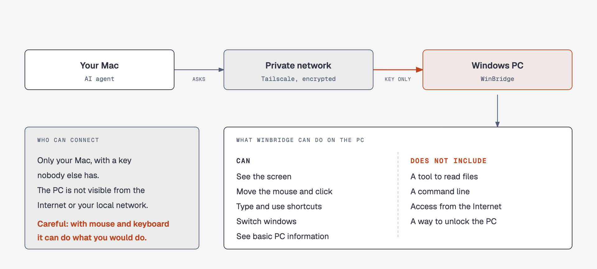
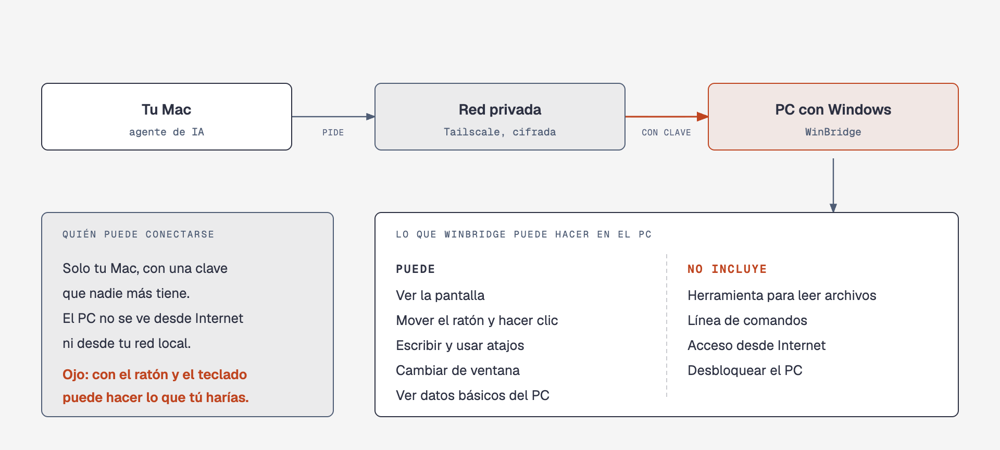

# WinBridge

> **Security notice / Aviso de seguridad.** WinBridge lets an AI agent use a real Windows PC: it can see the screen, move
> the mouse and type. Only connect it to a Mac you trust, and read [SECURITY.md](SECURITY.md) first. / *WinBridge deja que
> un agente de IA use un PC con Windows de verdad: ve la pantalla, mueve el ratón y escribe. Conéctalo solo a una Mac de
> tu confianza y lee antes [SECURITY.md](SECURITY.md).*

[English](#english) · [Español](#español)

## English

**Reader:** anyone curious about letting an AI assistant on a Mac work with a Windows PC, technical or not.

### What is it?

WinBridge lets an AI assistant on your Mac **use a Windows PC from a distance**, the way you would sit in front of it:
look at the screen, move the mouse, click and type.

It is useful when a task only works on that PC, for example a Windows-only program, and you want an assistant to help
with it without you being there.



[See the diagram full size](docs/diagrams/como-funciona-en.html)

### What can it do, and what can it not?

| It can | It does not include |
|---|---|
| See the screen | A tool to read or copy files |
| Move the mouse and click | A command line for the system |
| Type and use keyboard shortcuts | Access from the Internet |
| Switch between windows | A way to unlock the PC |
| Show basic information about the PC | |

The list of actions is short on purpose. WinBridge adds no tool for files or commands. Still, an assistant that can use the
mouse and keyboard can do whatever you could do in that open session. That is why you should only connect a Mac and an
assistant you trust.

### Is it safe?

WinBridge is built to be careful, but it is remote control, so it is not risk-free.

- **Only your Mac can connect.** The PC cannot be reached from the Internet or from your home network. Everything goes
  through [Tailscale](https://tailscale.com/), a private, encrypted network that links only your own devices.
- **A secret key is needed.** The key is created on your Mac and stored in its Keychain (and in Windows' credential
  store on the PC). Whoever has the key can use the PC, so do not share it.
- **It never unlocks the PC.** If the PC is locked, the assistant can only see the lock screen; it cannot control anything.
- **You can see and remove it.** It runs as a normal program on the PC, and the guide explains how to check it and how to
  remove it.

What the assistant sees on the screen goes to the AI app you use on your Mac. Do not leave passwords or private documents
open while it works.

The full list of risks and limits is in [SECURITY.md](SECURITY.md).

### What does it use?

| Piece | What it is for |
|---|---|
| **Tailscale** | The private network between your Mac and your PC |
| **A small program on the PC** (the agent) | Receives the requests and carries out the short list of actions |
| **A small command-line tool on the Mac** (`winbridge`) | Sets up the pairing and checks that everything works |
| **Your Mac's Keychain** | Keeps the secret key |

### Is it ready to use?

It is an early version (0.1.0). The update of an existing installation has been tested; a first install on a brand-new
Windows PC has not been tested end to end yet. Expect to need some technical help for the setup.

### Setting it up (for technical readers)

<details>
<summary>Requirements and step-by-step installation</summary>

**Requirements**

- A Windows 10 or 11 PC (x64) and a Mac. The `winbridge` command-line client runs **on macOS only** (it keeps the key in the
  Keychain with `security`).
- [Tailscale](https://tailscale.com/) on both machines, and SSH with a key from the Mac to the PC.
- Go 1.25 and Python 3.11+ with [uv](https://docs.astral.sh/uv/) to build; PowerShell 7 is recommended for the tests.

**Steps**

1. **Build the agent and the bundle** (on the Mac, from a clone of this repository):

   ```sh
   (cd agent && GOOS=windows GOARCH=amd64 CGO_ENABLED=0 \
     go build -ldflags "-X main.version=0.1.0" -o ../dist-go/winbridge-agent.exe ./cmd/winbridge-agent)
   uv run python tools/build_bundle.py --go-agent dist-go/winbridge-agent.exe \
     --ssh-public-key-file ~/.ssh/id_ed25519.pub
   ```

   Instead of compiling, you can download `winbridge-agent-windows-amd64.exe`, `winbridge-darwin-arm64` or
   `winbridge-darwin-amd64` and `SHA256SUMS` from the repository's Releases page, then check them:

   ```sh
   shasum -a 256 -c SHA256SUMS      # download all three binaries and SHA256SUMS first
   gh attestation verify winbridge-agent-windows-amd64.exe -R partprogramming09/winbridge
   ```

   Make a downloaded client runnable with `chmod +x winbridge-darwin-arm64` and
   `xattr -d com.apple.quarantine winbridge-darwin-arm64`, and move it to a folder on your `PATH` as `winbridge`. Pass the
   downloaded agent to `--go-agent`. No ready-made bundle is published, because the bundle carries *your* SSH public
   key.

   The `build_bundle.py` command prints the ZIP's SHA-256. Keep it: it is the trust anchor, so deliver it to the PC by a different channel
   than the ZIP.
2. **Install on the PC.** Copy the ZIP, check its SHA-256, extract the whole ZIP, open an elevated Windows PowerShell in that
   folder and run `powershell -NoProfile -ExecutionPolicy Bypass -File .\bootstrap.ps1`. Log in to Tailscale with the PC
   owner's account if asked. Details and options: [docs/guides/operar-winbridge.md](docs/guides/operar-winbridge.md).
3. **Build the client** (Mac): `(cd cli && go build -ldflags "-X main.version=0.1.0" -o ~/.local/bin/winbridge .)`.
4. **Register the PC and pair** (Mac): use the PC's Tailscale address and this Mac's Tailscale address.

   ```sh
   winbridge hosts add mypc --address 100.64.1.10 --user alice --client-ip 100.64.1.20
   winbridge adopt mypc
   winbridge status mypc
   winbridge doctor mypc
   ```

   `adopt` creates a 64-character key, stores it in the Keychain and sends it to the PC over SSH standard input.
   `status` should print `ok`, the version, `strict` and `9 tools`. Run `doctor` after every change and read its warnings.
5. **Update later** with a new bundle: `winbridge update mypc --bundle winbridge-0.1.0-bundle.zip`. If the new agent does not answer
   `/health`, the previous executable is put back (only the executable; see the operating guide).

Your MCP client connects to `http://<pc-tailscale-address>:8091/mcp` with the header `Authorization: Bearer <key>`.

</details>

### Learn more

- [SECURITY.md](SECURITY.md): reporting, the full list of risks and known limits.
- [docs/architecture.md](docs/architecture.md): how the pieces fit, for developers. Decision record:
  [ADR 0001](docs/adr/0001-perfil-estricto-solo-tailscale.md).
- [docs/guides/operar-winbridge.md](docs/guides/operar-winbridge.md): operating guide.
- [docs/AGENT-CONTRACT.md](docs/AGENT-CONTRACT.md), [docs/JOBS.md](docs/JOBS.md), [docs/GATEWAY.md](docs/GATEWAY.md).
- [CONTRIBUTING.md](CONTRIBUTING.md) and [CHANGELOG.md](CHANGELOG.md).

WinBridge is a fork of [winremote-mcp](https://github.com/dddabtc/winremote-mcp) 0.4.24 that keeps only a short, fixed list
of actions and works only through Tailscale. Licence: MIT ([LICENSE](LICENSE)); see [NOTICE](NOTICE).

## Español

**Lector:** cualquier persona curiosa por dejar que un asistente de IA en una Mac trabaje con un PC con Windows, sea técnica o no.

### ¿Qué es?

WinBridge deja que un asistente de IA en tu Mac **use un PC con Windows a distancia**, como si estuvieras sentado delante:
mirar la pantalla, mover el ratón, hacer clic y escribir.

Sirve cuando una tarea solo se puede hacer en ese PC, por ejemplo un programa que solo existe para Windows, y quieres que
un asistente te ayude sin que tú estés allí.



[Ver el diagrama a pantalla completa](docs/diagrams/como-funciona.html)

### ¿Qué puede hacer y qué no?

| Puede | No incluye |
|---|---|
| Ver la pantalla | Una herramienta para leer o copiar archivos |
| Mover el ratón y hacer clic | Una línea de comandos del sistema |
| Escribir y usar atajos de teclado | Acceso desde Internet |
| Cambiar de ventana | Una forma de desbloquear el PC |
| Mostrar datos básicos del PC | |

La lista de acciones es corta a propósito. WinBridge no añade herramientas de archivos ni de comandos. Aun así, un asistente
que maneja el ratón y el teclado puede hacer lo que tú harías en esa sesión abierta. Por eso solo debes conectar una Mac y un
asistente de tu confianza.

### ¿Es seguro?

WinBridge está hecho con cuidado, pero es control remoto, así que no está libre de riesgos.

- **Solo tu Mac puede conectarse.** No se llega al PC desde Internet ni desde tu red de casa. Todo pasa por
  [Tailscale](https://tailscale.com/), una red privada y cifrada que une solo tus propios dispositivos.
- **Hace falta una clave secreta.** Se crea en tu Mac y se guarda en su Llavero (y en el almacén de credenciales de Windows
  en el PC). Quien tenga la clave puede usar el PC: no la compartas.
- **Nunca desbloquea el PC.** Si el PC está bloqueado, el asistente solo ve la pantalla de bloqueo y no puede manejar nada.
- **Puedes ver y quitar el programa.** Corre como un programa normal en el PC, y la guía explica cómo comprobarlo y cómo
  quitarlo.

Lo que el asistente ve en la pantalla llega a la aplicación de IA que uses en tu Mac. No dejes contraseñas ni documentos
privados abiertos mientras trabaja.

La lista completa de riesgos y límites está en [SECURITY.md](SECURITY.md).

### ¿Qué usa?

| Pieza | Para qué sirve |
|---|---|
| **Tailscale** | La red privada entre tu Mac y tu PC |
| **Un programa pequeño en el PC** (el agente) | Recibe las peticiones y hace la lista corta de acciones |
| **Una herramienta de línea de comandos en la Mac** (`winbridge`) | Hace el emparejamiento y comprueba que todo funciona |
| **El Llavero de tu Mac** | Guarda la clave secreta |

### ¿Está listo para usarse?

Es una versión temprana (0.1.0). Se ha probado la actualización de una instalación que ya existía; una primera instalación
en un PC con Windows nuevo aún no se ha probado de principio a fin. Cuenta con necesitar ayuda técnica para instalarlo.

### Instalación (para personas técnicas)

Los pasos y las órdenes están en la sección plegable *Setting it up* de la parte en inglés (compilar el agente y el paquete,
instalar en el PC con `bootstrap.ps1`, compilar el cliente, `winbridge hosts add`, `winbridge adopt`, `winbridge status`,
`winbridge doctor`). Para actualizar: `winbridge update mypc --bundle winbridge-0.1.0-bundle.zip`. Tu cliente MCP se conecta a
`http://<dirección-tailscale-del-pc>:8091/mcp` con la cabecera `Authorization: Bearer <clave>`.

### Más información

- [SECURITY.md](SECURITY.md): cómo reportar, la lista completa de riesgos y límites conocidos.
- [docs/architecture.md](docs/architecture.md) (cómo encajan las piezas, para desarrolladores) y
  [docs/guides/operar-winbridge.md](docs/guides/operar-winbridge.md).
- [CONTRIBUTING.md](CONTRIBUTING.md) y [CHANGELOG.md](CHANGELOG.md).

WinBridge es una bifurcación de [winremote-mcp](https://github.com/dddabtc/winremote-mcp) 0.4.24 que conserva solo una lista
corta y fija de acciones y funciona solo por Tailscale. Licencia: MIT ([LICENSE](LICENSE)); ver [NOTICE](NOTICE).
