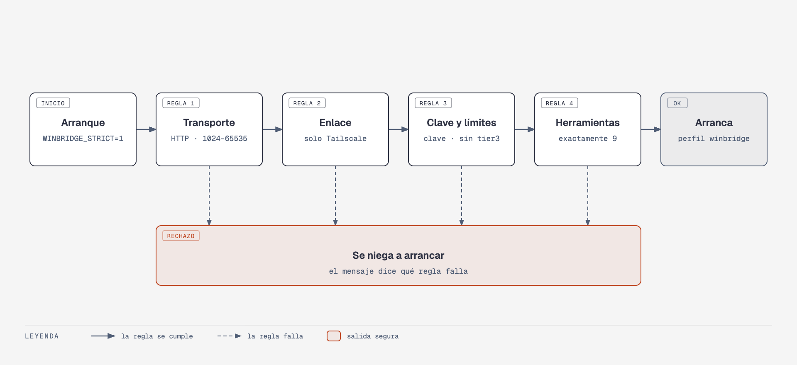

# Contrato del agente de WinBridge (fase G0)

**Lector:** personas

Extraído del servidor Python en `main` (commit `8ffe391`). El agente en Go debe cumplirlo; la prueba de paridad (G3)
lo comprueba contra las dos implementaciones. Las fuentes están entre paréntesis.

## HTTP

| Ruta | Autenticación | Respuesta |
| --- | --- | --- |
| `GET /health` | ninguna clave (única ruta sin clave); en el agente Go, solo para IP permitidas | `{"status":"ok","version","upstream","profile"}`; `profile` es `winbridge` en modo estricto (`__main__.py`, `health_check`) |
| `GET /status` | clave Bearer | `{"status","version","upstream","profile","strict","tools"(ordenadas),"tools_count","expected_tools_count"}`; nunca muestra la clave, la configuración ni el entorno (`status_check`) |
| `POST /mcp` (y `GET`/`DELETE`) | clave Bearer | MCP por HTTP en streaming |

- Clave: `Authorization: Bearer <clave>`; se compara en tiempo constante. Sin clave o con clave errónea:
  `401 {"error":"Unauthorized"}` (`auth.py`, `AuthKeyMiddleware`).
- Lista de IP: si el cliente no está en `security.ip_allowlist`: `403 {"error":"Forbidden: client IP <ip> is not in
  allowlist"}`; en el servidor Python `/health` queda exento (`security.py`, `IPAllowlistMiddleware`). El agente en Go es
  más estricto: una lista vacía no se acepta en modo estricto y `/health` también pasa por la lista (sin clave, pero solo
  para clientes permitidos; la propia dirección Tailscale del PC está en la lista, así que el doctor y el supervisor
  siguen funcionando).
- La clave llega solo por la variable de entorno `WINREMOTE_AUTH_KEY` (nunca por argumentos ni por `.env`; en modo
  estricto no se carga `.env`) (`__main__.py`, `WINBRIDGE_STRICT`).

## Modo estricto (`WINBRIDGE_STRICT=1`)

[Ver el diagrama a pantalla completa](diagrams/modo-estricto.html)

El agente se niega a arrancar, con un mensaje, salvo que se cumpla todo (`tiers.py`, `validate_winbridge_profile`):
1. transporte HTTP en streaming;
2. puerto entre 1024 y 65535;
3. dirección de enlace dentro de `100.64.0.0/10` o `fd7a:115c:a1e0::/48` (nunca `0.0.0.0`, `::`, loopback ni LAN);
4. clave presente;
5. sin `allow_insecure_remote`, sin `enable_all` ni `enable_tier3`;
6. las herramientas habilitadas son exactamente: `Snapshot`, `Click`, `Type`, `Move`, `Scroll`, `Shortcut`,
   `FocusWindow`, `Wait`, `GetSystemInfo`.

## Configuración (TOML, `bootstrap/config/winbridge.toml.template`)

`[server] host, port, allow_insecure_remote` · `[security] ip_allowlist, enable_tier3, disable_tier2` ·
`[tools] enable, exclude`. El instalador escribe este archivo; el agente en Go lo lee tal cual.

## Herramientas (`__main__.py`)

Todas devuelven texto; los errores se devuelven como error de herramienta con el prefijo `"<Tool> error: ..."`. El
servidor Python antepone `[task:<id>]` al texto (gestor de tareas); el agente en Go lo conserva para no cambiar el
formato que ven los clientes.

| Herramienta | Parámetros (por defecto) | Resultado |
| --- | --- | --- |
| `Snapshot` | `use_vision` (true), `quality` (75), `max_width` (0), `monitor` (0) | Imagen JPEG (si `use_vision`) y un texto con idioma, ventanas visibles con título `[handle] título (anchoxalto at x,y)` y hasta 50 elementos de la ventana activa `[índice] texto — center (x,y)`. La imagen va una sola vez |
| `Click` | `x`, `y`, `button` ("left"), `action` ("click" \| "double" \| "hover") | `Clicked left at (x,y)` / `Double-clicked ...` / `Hovered at (x,y)` |
| `Type` | `text`, `x` (0), `y` (0), `clear` (false), `press_enter` (false) | `Typed N chars`; con `x` o `y` hace clic antes; `clear` es Ctrl+A y Supr |
| `Move` | `x`, `y`, `drag` (false), `start_x` (0), `start_y` (0), `duration` (0.3) | `Moved to (x,y)` / `Dragged to (x,y)` |
| `Scroll` | `amount`, `x` (0), `y` (0), `horizontal` (false) | `Scrolled N vertically/horizontally`; positivo es arriba o derecha |
| `Shortcut` | `keys` ("ctrl+c", "alt+tab", "win+e") | `Executed shortcut: <keys>` |
| `FocusWindow` | `title` (""), `handle` (0) | `Focused window handle=H title='T'`; por título busca la mejor coincidencia parcial y exige puntuación 50 o más (`No window matching 'T' (best score N)`) |
| `Wait` | `seconds` (1.0) | `Waited Ns` |
| `GetSystemInfo` | ninguno | Sistema, CPU %, memoria, disco C:, red, tiempo encendido |

### Extensiones del agente en Go (2026-11-02)

El contrato de las 9 herramientas de perfil sigue siendo el del servidor Python. El agente en Go añade, por decisión del usuario
(prioridad: seguridad, evitar fricción y que la IA entienda qué pasa; el número de herramientas no importa):

- **`Diagnose` (integrada, solo lectura).** No está en `[tools] enable` ni cuenta en `tools_count`; `/status` la lista en
  `builtin_tools`. Parámetro `log_lines` (0 a 200, 20 por defecto). Devuelve el informe como JSON en el texto y como
  `structuredContent`: versión, `exe_sha256`, `pid`, `uptime_seconds`, memoria, `session` (`locked`, `input_desktop`),
  `last_install` (de `state\last-install.json`), `agent_selected` y las últimas líneas de `supervisor.log` y
  `server.err.log` con cualquier cadena parecida a una clave sustituida por `[redacted]`. Lee solo archivos fijos bajo la
  carpeta de instalación; el cliente no elige rutas.
- **Sesión bloqueada.** `Click`, `Type`, `Move`, `Scroll`, `Shortcut` y `FocusWindow` devuelven un error de herramienta
  (`the Windows session is locked ...`) en vez de un éxito falso cuando el escritorio de entrada no es `Default`
  (pantalla de bloqueo `Winlogon` o escritorio seguro del UAC). `Snapshot` y `GetSystemInfo` siguen funcionando y lo
  dicen en el texto (`**Session: LOCKED**`). Se lee en cada llamada, sin caché. En Windows 11 la pantalla de bloqueo se
  dibuja en el escritorio `Default` (medido en el laptop, 2026-11-04), así que además se pregunta al servicio de sesiones
  (`WTSQuerySessionInformation`, `SessionFlags`); `Diagnose` lo muestra como `input_desktop: "Default (lock screen)"`.
- **Ventana elevada delante.** Si la ventana en primer plano es de un proceso con más privilegios que el agente (que no
  está elevado), Windows descarta su ratón y teclado sin dar error (`SetCursorPos failed: The operation completed
  successfully`). `Click`, `Type`, `Move`, `Scroll` y `Shortcut` lo detectan y devuelven `an administrator window ("título")
  is in front ...`; `FocusWindow` no se bloquea por esto (sirve para traer una ventana normal al frente). `Diagnose`
  añade `session.elevated_foreground` (título, o vacío). Si no puede saberse, no se bloquea nada.
- **Escritura (`Type`).** Por defecto el texto se pega por el portapapeles y después se restaura el texto que había (si el
  portapapeles tiene algo que no es texto, no se toca y se escribe con teclas). El parámetro opcional `method` acepta `paste`
  (por defecto) o `keys`, que envía un evento Unicode por carácter con 12 ms entre ellos, para campos que bloquean el pegado.
  Motivo: probado en la laptop real, los paquetes Unicode rápidos hacían que el Bloc de notas repitiera el último carácter
  (`WinBridge` salía como `gggggggg`) y enviar teclas reales con Shift o AltGr perdía mayúsculas y letras en esa misma app.
  Pegar fue exacto con mayúsculas, acentos, `ñ`, `|`, `~`, `@` y `€` en el diálogo Ejecutar. Las aplicaciones procesan la entrada
  un instante después de que la herramienta responde: conviene esperar un segundo antes de capturar.
- **`Diagnose.session.modifiers_held`.** Lista las teclas modificadoras (shift, ctrl, alt, win) que Windows cree pulsadas, para
  detectar una liberación perdida.
- **`Processes` (integrada, solo lectura).** Lista los procesos (pid, pid padre, nombre, sesión de Windows y ruta si es
  legible); parámetros `name` y `limit` (1 a 500). Tampoco cuenta en `tools_count` y no comprueba la sesión bloqueada.
- **Paridad.** Las 9 herramientas de perfil deben coincidir exactamente con el contrato; `Diagnose` y `Processes` son las
  únicas extras que existen siempre, y `parity-check` comprueba además el informe de `Diagnose`. El agente Python no las tiene.

- **Trabajos (solo con `[jobs] root` en `local.toml`).** `ListJobs`, `SubmitJob`, `JobStatus`, `WaitJob` y `CancelJob` son
  herramientas integradas: aparecen en `/status.builtin_tools`, no en `tools_count`, y no comprueban la sesión bloqueada
  porque no tocan el escritorio. Ver `JOBS.md`.

- **Archivos (solo con `[files] read_roots` en `local.toml`).** `ListFiles{path}` y `ReadFile{path, encoding?, offset?}` son
  herramientas integradas de solo lectura: aparecen en `/status.builtin_tools`, no en `tools_count`. Solo alcanzan las
  carpetas de `read_roots`; una ruta fuera de ellas, con trucos de Windows (`..`, flujos `a:s`, `NUL`, nombres 8.3, `\\?\`,
  UNC) o a través de un enlace o unión que salga, da un error y nunca contenido. `ListFiles` devuelve como mucho 500
  entradas; `ReadFile` devuelve hasta `max_bytes` (256 KiB por defecto, tope 1 MiB) como UTF-8 o `base64` y marca
  `truncated`. `parity-check` las salta como las de trabajos. Ver el ADR 0003.

Los booleanos se aceptan como `true`/`false` o como las cadenas `"true"`, `"1"`, `"yes"` (`_tobool`).

## Fuera del contrato

OAuth, las otras 36 herramientas, `--allow-insecure-remote`, el transporte stdio y la configuración por línea de
comandos de herramientas (el perfil estricto las fija).
