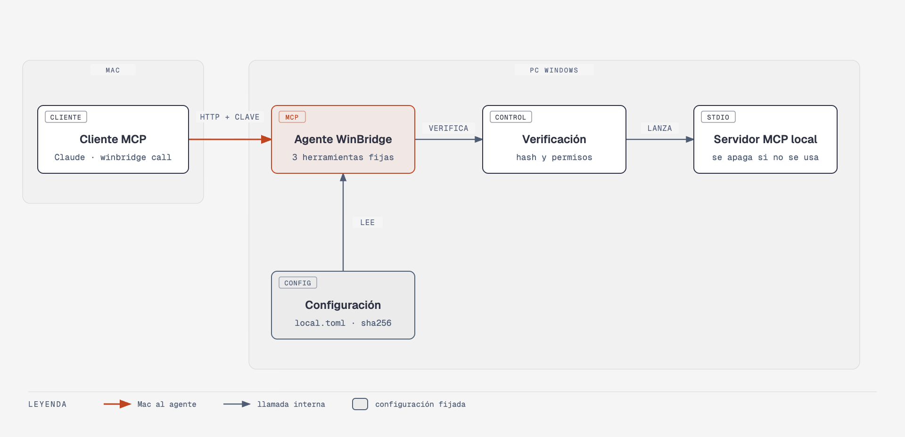

# MCP gateway

**Lector:** personas

The agent can call tools of other MCP servers on the same machine without a change to WinBridge: adding a server is
adding data to `config\local.toml`. It is the same idea as `RunTask` (pinned scripts, no command line from the caller),
applied to MCP servers that speak stdio.



[Open the diagram full screen](diagrams/pasarela.html)

## What the caller sees

Three fixed tools appear only when at least one `[servers.<name>]` exists. They are reported in `/status.builtin_tools`
and do not change `tools_count`, so the strict nine-tool profile and the parity check are unchanged without servers.

| Tool | Does |
|---|---|
| `ListServers` | Server names and the tools allowed on each. Reads no child. |
| `ServerTools(server)` | The allowed tools the child offers, with descriptions and schemas. The text comes from the child and is marked as data. |
| `CallServerTool(server, tool, arguments)` | Forwards one `tools/call`. `arguments` is data for that tool, never a command line. |

`ServerTools` and `CallServerTool` fail while the Windows session is locked, like the input tools.

## Configuration

`%LOCALAPPDATA%\winbridge\config\local.toml` is appended to the generated `winbridge.toml` every time the installer or an
update rewrites it, so it survives updates. It may only hold `[tasks.*]`, `[servers.*]` and `[jobs]` tables (`[jobs]` is described in `JOBS.md`).

```toml
[servers.metal-gpu-trace]
command = 'C:\Users\me\AppData\Local\winbridge\servers\metal-gpu-trace\run.cmd'   # absolute; pinned by sha256
args = []                       # fixed, written by the administrator
sha256 = '<hash of command>'    # checked at every start of the child
allow_tools = ['perf_attach', 'perf_runs', 'perf_record']   # required; the only child tools a caller may list or call
timeout = 700                   # seconds per call (default 120)
idle = 300                      # seconds an idle child stays alive (default 300)
max_output = 40000              # bytes per text block (default 40000)

[servers.metal-gpu-trace.deny_args]   # per tool: argument names a call may not contain
perf_record = ['program', 'wine', 'prefix', 'workdir', 'args']

[servers.metal-gpu-trace.files]  # more files pinned the same way, for example the Python modules the launcher loads
'C:\...\metal_trace_mcp.py' = '<hash>'

[servers.metal-gpu-trace.env]    # added to the child's environment
METAL_TRACE_OUT = 'C:\...\perf-runs'
```

`bootstrap/scripts/Set-WinBridgeServer.ps1` writes a table for you: it hashes the launcher and the `-PinFiles`, writes
`local.toml`, asks the agent to validate it (`winbridge-agent --print-config`), puts the old file back if the agent
rejects it, and restarts the agent. `-Remove` deletes a server.

## Behaviour

- One child per server, started on first use and stopped after `idle` seconds counted from the end of the last call.
- Calls to one server run one at a time; the input lock of the desktop tools is not held, so a long recording does not
  block Click or Type.
- The launcher and every pinned file are hashed at each start, and on Windows each of them and its folder must not give write access to Everyone, Authenticated Users or Users. A mismatch or an open permission refuses to start the child.
- The child gets the agent's environment without `WINBRIDGE_*` and `WINREMOTE_*`, plus the server's `env`; it runs
  without a console window.
- A cancelled call sends `notifications/cancelled` to the child; a call that overruns `timeout` or a child that stops
  answering ends the child and everything it started (`taskkill /T`).
- Progress from the child is forwarded when the caller sent a progress token; if the child is silent for 30 s the agent
  reports "still running" so the caller does not see the connection as idle.
- Text blocks over `max_output` are cut on a rune boundary, images over 8 MiB and oversized structured content are
  dropped, and a note says so.

## What it does not protect against

- The hash pins files, not what they load. Pin the scripts and modules the launcher uses (`files`). The permission check
  only looks at the pinned files and their folders, not at the Python packages or DLLs the child imports.
- Every allowed tool is a decision by the administrator: a child tool that runs programs or writes files gives that power
  to whoever holds the WinBridge key. List only the tools needed, and use `deny_args` to remove the dangerous
  parameters of a tool that is otherwise useful. For `metal-gpu-trace`, `perf_record` is allowed but a call that contains
  `program`, `wine`, `prefix`, `workdir` or `args` is refused, so it can only run a test program named in
  `data/workloads.json`; that file is pinned in `files`, so its paths and hashes cannot change unnoticed.
  `workload_fetch` takes only a name and checks the download against that same pinned file. `presentmon_install` stays
  out: PresentMon is installed once by the administrator.
- The Mac is already the only client (`ip_allowlist` and the key in its Keychain), so a separate "only from the Mac"
  lock adds nothing. What `deny_args` limits is what a caller holding the key, human or AI, can make the server do.
- Input tools and the gateway share the same key; locking the session blocks both.

## Measured on the real laptop

- A 360 s call through the agent over HTTP, with the child reporting progress every 20 s, finished with `slept 6m0s`
  and every progress notification reached an SDK client. The agent has no write timeout and the session timeout counts
  idle time, so nothing cut the call.
- A restart of the agent during a call ends the call (`request terminated without response`); do not restart while a
  long call runs.
- `metal-gpu-trace` through the gateway: `ServerTools` and `ListServers` work, and `perf_attach` starts PresentMon with
  the agent's own token (the account is in "Performance Log Users"; no elevation is needed). An idle or minimised
  process answers `no frame data`, which is the server's own message. Frame capture of a program that is drawing was
  not exercised.
- A file written by an elevated session (an SSH login as an administrator) can be owned by Administrators with a
  protected ACL that leaves the normal token out: `PresentMon.exe` installed that way failed to start under the agent
  with `[WinError 5]`. Install child programs with the same token the agent uses, or grant the account read and execute
  with `icacls <file> /grant <user>:(RX)`.
- Claude Code as the client (it needs `/mcp` to see the three new tools): a 400 s call finished with `slept 6m40s`, past
  the 5 minute idle limit for network servers, and stopping a running call ended the child process within seconds and
  left the server ready for the next call. Whether Claude Code sends a progress token is not known; the call survived
  either way.
