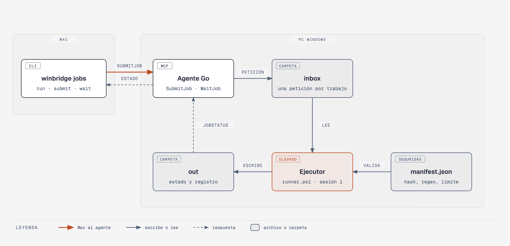

# Trabajos remotos (job runner)

**Lector:** personas

Permite lanzar, desde la Mac, un conjunto cerrado de scripts del laptop **elevados y en la sesión del escritorio**, esperarlos horas, cancelarlos y leer su registro por tramos. El agente de WinBridge sigue sin elevar: solo deja una petición en una carpeta y lee el resultado.

El diseño, las decisiones y el estado de la implementación se llevan en la documentación privada del proyecto.



[Ver el diagrama a pantalla completa](diagrams/trabajos.html)

## Piezas

| Pieza | Dónde | Qué hace |
| --- | --- | --- |
| `ListJobs`, `SubmitJob`, `JobStatus`, `WaitJob`, `CancelJob` | agente Go (`agent/internal/tools/jobs.go`, `agent/internal/jobs`) | Herramientas integradas: aparecen en `/status.builtin_tools`, no cambian `tools_count`; funcionan con la sesión bloqueada |
| `runner.ps1` | laptop, tarea `WinBridgeJobs-Run` (elevada, interactiva, siempre viva) | Lee `inbox\`, valida contra `manifest.json`, ejecuta, escribe `out\` |
| `Install-WinBridgeJobs.ps1` | laptop, administrador | Crea la carpeta con permisos por SID, copia paquetes, escribe el manifiesto con los hashes, registra la tarea (`-Update`: sin tareas) |
| `Set-WinBridgeJobs.ps1` | laptop, usuario | Escribe `[jobs] root = '...'` en `local.toml`, valida con el agente y reinicia |
| `winbridge jobs ...`, `winbridge call ...` | Mac (`cli/`) | Cliente único para personas y scripts |

## Carpeta del ejecutor (`C:\ProgramData\WinBridgeJobs`)

```
manifest.json   solo administradores: trabajos, hash del script, regex por parámetro, límite, sesión, env
runner.ps1      solo administradores
scripts\        solo administradores
inbox\          el agente escribe peticiones {job,args,queue}
cancel\         el agente escribe un archivo con el id para cancelar
out\            el ejecutor escribe <id>.status.json, <id>.log, <id>.err.log, <id>.request.json
```

## Paquetes de trabajos

Un paquete es una carpeta con `manifest.json` y `scripts\`:

```json
{ "jobs": { "game": { "script": "game.ps1", "timeout_s": 90, "session": 1,
    "description": "Abre el juego de prueba",
    "params": { "Api": "^(d3d11|d3d12)$", "Dim": "^[0-9]{1,3}$" } } },
  "env": { "TOOLS_DIR": "{root}\\tools" } }
```

`Install-WinBridgeJobs.ps1 -Packages <carpeta>` junta todos los paquetes en un manifiesto. Dos paquetes no pueden definir el mismo trabajo ni el mismo nombre de script. Cada parámetro es un valor, nunca una línea de comandos; la regex del manifiesto es la única validación de los valores, y se aplica otra vez en el ejecutor.

## Uso desde la Mac

```sh
winbridge jobs list
winbridge jobs run game Api=d3d11 Dim=30       # envía, espera por tramos de 100 s, imprime el registro y el estado
winbridge jobs submit ab Reps=5 -queue         # devuelve el id; con -queue espera su turno
winbridge jobs wait ID                         # hasta 100 s; vuelve a llamar si sigue running
winbridge jobs status ID -offset 8000 -limit 8000
winbridge jobs busy
winbridge jobs cancel ID
winbridge call GetSystemInfo
winbridge call Wait -args '{"seconds":1}'
```

`run` sale con error si el trabajo no termina `done`. Las consultas de solo lectura se reintentan dos veces ante un fallo de red; `submit` y `cancel` nunca, para no duplicar.

## Con la pantalla bloqueada

Verificado en el laptop (2026-11-04) con la sesión bloqueada: `ListJobs`, `SubmitJob`, `JobStatus`, `WaitJob`, `CancelJob`, `Processes` y los trabajos en sesión 1 (`smoke`: `session_id=1 elevated=True`) funcionan; `SubmitJob` mientras corre otro devuelve `busy` con su id, y `CancelJob` deja el trabajo `cancelled`. Las herramientas de entrada devuelven `the Windows session is locked` y el gateway se niega, como está documentado.

## Estados

`queued` (petición en `inbox\`), `running`, `done`, `failed` (código distinto de 0), `timeout`, `rejected` (no pasó la validación; el motivo va en `error`), `cancelled`.

## Reglas

- Un trabajo a la vez. `SubmitJob` sin `queue` falla con `busy` y los ids activos.
- **`TEMP` de los trabajos (para quien escribe un paquete):** el ejecutor da a cada trabajo `TEMP` y `TMP` = `C:\ProgramData\WinBridgeJobs\tmp`, que solo escriben administradores, y es el único sitio donde puede compilar `Add-Type`. Lo que deba escribir o conservar el usuario (perfiles de navegador, archivos que otro programa debe leer) necesita una **ruta explícita** del área del usuario, por ejemplo `Join-Path $env:LOCALAPPDATA 'Temp'`. Medido en el laptop (2026-11-04): con ese `TEMP`, Chrome sin ventana con `--user-data-dir=$env:TEMP\...` arrancó 0 procesos (creó la carpeta y no avanzó); con `%LOCALAPPDATA%\Temp` arrancó 12. El paquete de VegaFlow lo sufrió: `bg-factors` terminó "bien" pero con `procesos=0`, sin carga de fondo, y dio ~124 fps en todas las condiciones. Ante un trabajo que arranque programas sin ventana, comprueba que arrancaron de verdad (cuenta de procesos) y no te fíes solo del código de salida. No se cambia el `TEMP` de todos los trabajos con `env` del manifiesto: reabriría el vector de `Add-Type` para ese paquete.
- **Limpieza:** al arrancar y cada 6 horas el ejecutor borra de `out\` todos los archivos (estado, registro, errores, petición) de los trabajos terminados hace más de 14 días (`-KeepDays` del ejecutor), nunca los de uno en curso ni archivos que no sean suyos; borra también marcadores de `cancel\` y archivos de `tmp\` de más de un día. Se anota en `runner.log` (`cleanup: ...`).
- **Trabajo interrumpido:** si el ejecutor se detiene a mitad de un trabajo (reinicio, caída, reinicio manual de la tarea), al volver lo marca `failed` con el error `the runner stopped while this job was running`. Antes quedaba en `running` y el agente lo contaba como ocupado para siempre. El proceso del trabajo, si siguió vivo, no se detiene.
- Cancelar mata el árbol de procesos del trabajo.
- Un reinicio del agente mientras se espera termina esa llamada, pero no el trabajo: vuelve a consultar con el id.
- Solo sesión 1 (escritorio). Un trabajo con `"session": 0` se rechaza; todavía no hay ejecutor de sesión 0.
- El hash se comprueba justo antes de lanzar el script; la carpeta `scripts\` solo la escriben administradores.

## Aplicaciones (.exe)

Un paquete puede declarar `apps`: programas que el agente puede abrir **por nombre**, nunca por ruta.

```json
{ "apps": { "juego": { "path": "{root}\\tools\\juego\\juego.exe", "sha256": "…(opcional)", "args": "^-windowed( -dim [0-9]{1,3})?$",
            "window_title": "Mi Juego", "description": "…" } } }
```

El paquete `apps` (incluido) aporta dos trabajos: `app-run` (parámetros `App` y, si la app declara `args`, `AppArgs`) y `app-stop`. Se abre visible en la sesión del escritorio; `app-run` espera a que aparezca la ventana (`window_title`, regex) e imprime pid y título. `app-stop` mata el árbol de procesos que abrió `app-run`, comprobando antes pid y hora de inicio.

```sh
winbridge jobs list                       # "apps": las permitidas, con su regex de argumentos
winbridge jobs run app-run App=winver
winbridge call Processes -args '{"name":"winver"}'    # pid, ppid, sesión, ruta (solo lectura)
winbridge jobs run app-stop App=winver
```

`Processes` es una herramienta integrada de solo lectura (nombre y `limit`); funciona con la sesión bloqueada. La ruta de una aplicación solo es legible si Windows deja al agente abrir ese proceso.

Reglas para quien registra una app (el instalador comprueba las marcadas con ✔):
- ✔ Ruta con letra de unidad, sin UNC. ✔ Fuera de Windows, Program Files y la carpeta de trabajos hace falta `sha256`: un `.exe` que la cuenta del agente pudiera reemplazar correría elevado.
- ✔ La regex `args` enumera lo permitido (`^(--port [0-9]{1,5})?$`); no se admiten `.*`, `.+`, ni `\\` o `//` en ella. Sin `args`, la app no recibe ningún argumento.
- ✔ Dos nombres no pueden diferir solo por mayúsculas (comparten archivo de estado).
- No registrar intérpretes ni shells (`cmd`, `powershell`, `wscript`, `msiexec`, `python`), ni programas que abran rutas, URLs o ejecuten comandos: con `run_as: "admin"` serían ejecución elevada para quien tenga la clave, y con `user` ejecución con la cuenta del usuario. (`ise` está en el paquete `smoke` solo para probar `ui`.)
- Los errores de un trabajo llegan al agente (`stderr` de `JobStatus`): los scripts de apps no deben imprimir rutas ni secretos.

**Elevación.** Por defecto (`run_as: "user"`) `app-run` lanza la app con el token del escritorio del usuario (el de `explorer`), con integridad media como el agente. Con `run_as: "admin"` la app hereda el token elevado del ejecutor. Se midió en el laptop (2026-11-04): mientras una app **elevada** está delante, el `Click`, `Type` y `Move` del agente fallan (`SetCursorPos failed`); lanzada con `user` (integridad 0x2000, la del agente) funcionan. Con `user` la app recibe además el entorno del propio usuario (construido desde su token), no las variables del ejecutor elevado. Por eso `admin` solo es para programas que de verdad lo necesiten, de confianza y con argumentos acotados. `args` sin declarar significa "ningún argumento". El paquete `smoke` registra `winver` solo para probar; `bootstrap\jobs\examples\uitest` (PowerShell ISE, para probar `ui click` con botones reales) **no se instala por defecto**: da un editor de PowerShell a quien pueda escribir en él; cópialo a `packages\` solo mientras pruebas.

## Pulsar por nombre (`ui`)

El trabajo `ui` (paquete `ui`) usa UI Automation dentro de una app abierta con `app-run`; no opera sobre ventanas ajenas a ese registro.

```sh
winbridge jobs run ui App=ise Action=list                       # elementos con nombre: tipo, enabled, centro (x, y)
winbridge jobs run ui App=ise Action=list Filter=script
winbridge jobs run ui App=ise Action=click "Name=Nuevo script"  # Invoke, Toggle o Select del único elemento habilitado con ese nombre
```

`click` falla si no hay ninguno habilitado con ese nombre o hay varios (se ven con `list`). Muchos programas clásicos (el diálogo de `winver`, el Mapa de caracteres, Conexión a Escritorio remoto) exponen sus botones como `Pane` sin patrón de pulsación: `click` lo dice e indica las coordenadas para usar `Click` del agente. Verificado en el laptop: `list` en `winver`, `charmap`, `mstsc` e `ise` (paquete de ejemplo); `click` pulsó "Nuevo script" en ISE (apareció la pestaña `Sin título1.ps1`) y rechazó un elemento inexistente y uno deshabilitado; `Click` por coordenadas de `list` cerró `winver`.

## Límites de seguridad conocidos

- **El ejecutor corre con la misma cuenta que el agente** (con privilegios elevados), y UAC no es una frontera de seguridad frente a un proceso de esa cuenta. Una cuenta de administrador aparte no sirve: una tarea interactiva solo corre en la sesión de su propia cuenta, y los trabajos necesitan la sesión de escritorio (juegos, ventanas de `app-run`, PresentMon).
  - **Cerrado:** los trabajos reciben un entorno construido por el ejecutor: `PATH` solo de sistema, `PSModulePath` solo de sistema (el PowerShell añade además `Program Files\WindowsPowerShell\Modules`, solo de administradores) y `TEMP`/`TMP` en `<raíz>\tmp`, que solo escriben administradores (ahí compila `Add-Type`). Comprobado con un ejecutor arrancado con `PATH`, módulos y `TEMP` hostiles (`tools/test-jobs-runner.ps1`) y con `smoke`, que imprime `temp=`, `path=` y `psmodulepath=`. El manifiesto (`env`) se aplica encima.
  - **Cerrado para los trabajos:** el ejecutor borra de su entorno las variables de perfilado y de enganche de .NET (`COR_*`, `CORECLR_*`, `DOTNET_STARTUP_HOOKS`), así que los procesos de los trabajos no las heredan.
  - **Sigue abierto, no se puede cerrar por script:** el propio proceso del ejecutor arranca con el entorno de la cuenta (incluido `HKCU\Environment`) antes de que corra la primera línea de `runner.ps1`; si el agente escribe ahí una variable de perfilado, el ejecutor ya la habrá cargado. Documentado, no corregido.
  - **Sigue abierto:** lo que comparte el perfil y `HKCU` de la cuenta (por ejemplo, clases COM registradas por usuario que cargue un script elevado, o el perfil de PowerShell si algún trabajo lo cargara). Cerrarlo del todo exige que el ejecutor corra como SYSTEM y lance cada trabajo en tu sesión (opción 2 del plan): requiere UAC y otra revisión.
- La regex del manifiesto es la única validación de los valores: se aplica entera (`\A(...)\z`), distingue mayúsculas, y un valor no puede empezar por `-`, pasar de 200 bytes ni llevar comillas, controles o `\` final.
- Cola limitada a 20 trabajos.
- La bitácora `runner.log` está en la carpeta protegida; los registros de trabajos pueden contener rutas y texto de scripts elevados: los scripts no deben imprimir secretos.
- Si la carpeta ya existía, el instalador se niega (otro usuario habría podido conservar permisos sobre ella).

## Instalar (una vez, con UAC)

```powershell
# elevado, en el laptop
.\bootstrap\jobs\Install-WinBridgeJobs.ps1 -Packages C:\ruta\paquetes -AgentUser <cuenta del agente> -RunnerSha256 <hash del bundle>
# como usuario
.\bootstrap\scripts\Set-WinBridgeJobs.ps1
```

Ejecuta el instalador y los paquetes desde el bundle recién extraído y verificado, nunca desde `bin\jobs` (esa carpeta la puede escribir la cuenta del agente): el hash solo protege `runner.ps1`, no el instalador ni los scripts de los paquetes. El hash de `runner.ps1` sale del `manifest.json` del bundle (archivo `bootstrap/jobs/runner.ps1`) o del campo `runner_sha256` que imprime `winbridge update`; el instalador compara los bytes de `runner.ps1` con él antes de copiarlos y se niega si difieren (`runner hash mismatch`).

`bootstrap\jobs\packages\smoke` es un paquete de prueba (un trabajo `smoke`). Para verificar una instalación desde la Mac:

```sh
winbridge jobs run smoke Word=hola
# esperado: user=<PC>\<cuenta>  session_id=1  elevated=True  word=hola   (y estado done)
```

`session_id=1` y `elevated=True` a la vez demuestran la tarea interactiva y elevada; `session_id=0` significa que el ejecutor corre como servicio o por SSH, no como tarea del escritorio.

Actualizar scripts o manifiesto sin tareas: `Install-WinBridgeJobs.ps1 -Packages ... -Update -RunnerSha256 <hash del bundle>` por SSH como administrador. Si cambió `runner.ps1`, reinicia la tarea cuando no haya trabajos en curso.

Quitar: `Set-WinBridgeJobs.ps1 -Remove`, `Unregister-ScheduledTask WinBridgeJobs-Run` y borrar la carpeta.
