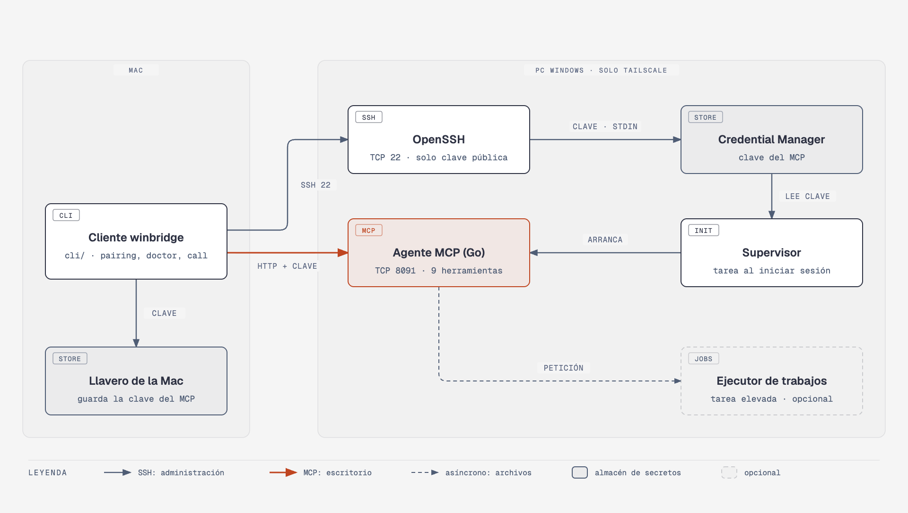
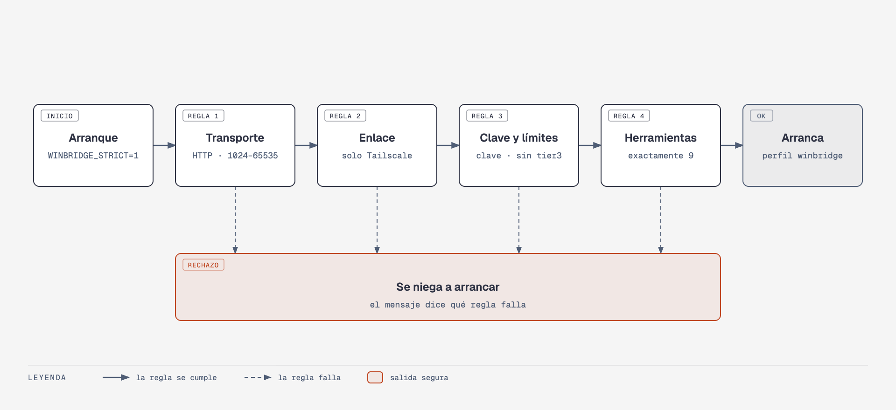

# Arquitectura de WinBridge

**Lector:** personas
**Última revisión:** 2026-11-14

WinBridge convierte un PC con Windows en un punto de soporte estrecho, accesible solo por Tailscale, para una Mac de
confianza. La Mac ve el escritorio y lo maneja con pocas herramientas MCP; no hay shell remoto ni acceso a archivos.

## Por qué está hecho así

Un servidor MCP de escritorio remoto es potente: quien lo alcanza controla el ratón y el teclado. Por eso la
arquitectura reduce lo que se puede hacer y lo que se puede alcanzar. Cada pieza de abajo existe para cerrar una
puerta, no para añadir una función. La decisión de fondo está en [ADR 0001](adr/0001-perfil-estricto-solo-tailscale.md).

## Cómo encaja

[Ver el diagrama a pantalla completa](diagrams/arquitectura.html)

Dos caminos separados, con credenciales distintas:

| Camino | Para qué | Cómo se protege |
| --- | --- | --- |
| SSH, TCP 22 | Administrar el PC: instalar, pairing, doctor, logs, reiniciar, actualizar | Solo clave pública (sin contraseña), regla de firewall limitada a los rangos de Tailscale |
| MCP por HTTP, TCP 8091 por defecto | Usar las herramientas de escritorio | Clave Bearer, lista de IP permitidas, enlace solo a la dirección Tailscale del PC |

Ejemplo: la Mac pide una captura. Llega `POST /mcp` con `Authorization: Bearer <clave>` a la IP Tailscale del PC. El
servidor comprueba la clave y que la IP del cliente esté permitida, y ejecuta `Snapshot`. Si Windows está bloqueado,
la herramienta lo dice en vez de devolver un éxito falso. Nada de esto abre un puerto a la LAN ni a Internet.

## Piezas

| Pieza | Dónde en el repo | Qué hace |
| --- | --- | --- |
| Cliente `winbridge` | `cli/` | Corre en la Mac. Hace pairing, `status`, `doctor`, `logs`, `restart`, `update`, `call` y `jobs`. Guarda la clave en el llavero de la Mac y la envía por SSH por entrada estándar |
| Agente Go `winbridge-agent` | `agent/` | Servidor MCP en el PC. Usa el SDK oficial de MCP para Go. Contrato en [AGENT-CONTRACT.md](AGENT-CONTRACT.md) |
| Servidor Python | `src/winremote/` | Servidor heredado de upstream (`winremote-mcp 0.4.24`). Cumple el mismo perfil estricto |
| Instalador y scripts | `bootstrap/` | PowerShell. Instala OpenSSH, reglas de firewall, entorno y tarea programada; trae el `doctor` y los scripts de gestión |
| Ejecutor de trabajos | `bootstrap/jobs/` | Tarea elevada aparte que corre un conjunto cerrado de scripts. Ver [JOBS.md](JOBS.md) |
| Pasarela MCP | `agent/internal/gateway/` | Llama a herramientas de otros servidores MCP locales, solo los configurados. Ver [GATEWAY.md](GATEWAY.md) |

En el PC, una tarea programada al iniciar sesión arranca un supervisor, y el supervisor arranca el servidor. La clave
vive en el Credential Manager de Windows y el supervisor la pasa al servidor por variable de entorno, nunca por la
línea de comandos.

## Lo que garantiza el modo estricto

Con `WINBRIDGE_STRICT=1` el servidor se niega a arrancar salvo que se cumpla todo (detalle en
[AGENT-CONTRACT.md](AGENT-CONTRACT.md)):

1. transporte HTTP en streaming y puerto entre 1024 y 65535;
2. enlace dentro de `100.64.0.0/10` o `fd7a:115c:a1e0::/48` (nunca `0.0.0.0`, `::`, loopback ni LAN);
3. clave presente (el servidor Python rechaza además `allow_insecure_remote`, `enable_all` y `enable_tier3`; el agente Go
   no tiene esos campos);
4. las herramientas habilitadas son exactamente nueve: `Snapshot`, `Click`, `Type`, `Move`, `Scroll`, `Shortcut`,
   `FocusWindow`, `Wait`, `GetSystemInfo`.

Las 9 herramientas de perfil son las únicas que cuentan. El agente Go añade herramientas **integradas**: `Diagnose` y
`Processes` (siempre, solo lectura) y, si `local.toml` define `[jobs]`, `[servers]` o `[tasks]`, las de trabajos (`SubmitJob`…) y las
de pasarela (`CallServerTool`…). No cuentan en `tools_count`; `/status` las lista en `builtin_tools`, para que las 9
herramientas de perfil se puedan seguir comprobando. Con `[tasks]` aparece además `RunTask`, que sí entra en `tools` y
en `tools_count`.

## Lo que no hace

Sin shell, sin escritura de archivos, sin escritura del registro, sin control de servicios, sin portapapeles remoto
más allá de lo que usa `Type`, y sin autologon: si la sesión está bloqueada, las herramientas de escritorio fallan con
un mensaje claro en vez de saltarse el bloqueo.

## Para seguir leyendo

- Operación diaria, instalación y pairing: [guides/operar-winbridge.md](guides/operar-winbridge.md).
- Contrato exacto de HTTP, estricto y herramientas: [AGENT-CONTRACT.md](AGENT-CONTRACT.md).
