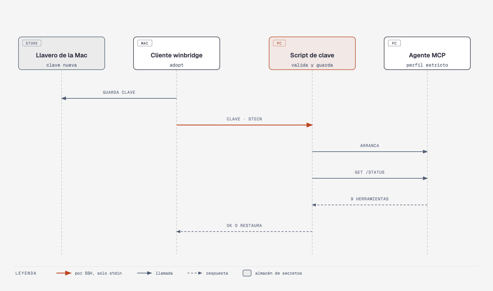

# WinBridge operating guide

**Lector:** personas
**Última revisión:** 2026-11-14

WinBridge is a fork of [winremote-mcp](https://github.com/dddabtc/winremote-mcp)
that turns a Windows PC into a narrow, Tailscale-only endpoint for a trusted Mac. It is not a general
remote-administration product. This guide is for the person who installs and operates it; the contract of the agent is in
[AGENT-CONTRACT.md](../AGENT-CONTRACT.md) and the shape of the system in [architecture.md](../architecture.md).

- Agent: the native Go agent (`agent/`), default port **8091**.
- The inherited Python server (`src/winremote`) listens on 8090 by default upstream; it is kept for reference. The installer
  deploys the Go agent; the supervisor falls back to the Python server only if the Go agent keeps failing.
- Client: the `winbridge` command-line tool for macOS (`cli/`).
- Upstream base: `winremote-mcp 0.4.24`, tag `v0.4.24`, commit `f177b74dfb1973d432054603bcab608def826b82`.
- Install root on the PC: `%LOCALAPPDATA%\winbridge`.

## What this fork adds

1. A fixed **9-tool profile**: `Snapshot`, `Click`, `Type`, `Move`, `Scroll`,
   `Shortcut`, `FocusWindow`, `Wait`, `GetSystemInfo`.
2. A strict-mode guard. With `WINBRIDGE_STRICT=1` the server refuses to start
   unless it is bound to a Tailscale address, has an auth key, uses streamable
   HTTP on a non-privileged port, has Tier 3 disabled, and exposes exactly those
   nine tools.
3. A one-script Windows bootstrap that installs and configures OpenSSH Server,
   Tailscale checks, Tailscale-only firewall rules, a CPython 3.12 virtual
   environment, an offline hash-locked wheel set, a per-user supervisor, and a
   logon scheduled task.
4. A pairing path that keeps the auth key out of files, the repository, command
   lines, and logs: the Mac pipes the key over SSH to a script that writes it
   directly to Windows Credential Manager.
5. Management scripts for doctor/status, logs, restart, client allowlist, update
   with rollback, and removal.
6. A native Go agent, with the built-in read-only tools `Processes` and `Diagnose`, plus optional job and gateway tools that
   are not counted among the nine profile tools.
7. The `winbridge` client for macOS: `hosts`, `adopt`, `status`, `doctor`, `logs`, `restart`, `update`, `call` and `jobs`.

Some upstream documents remain in `docs/` for reference and say so in their header. This file
describes the fork's security contract and operational flow.

## Topology

```
Mac (Tailscale 100.x / fd7a:...)
  |  SSH TCP 22      -> OpenSSH Server, key-only, Tailscale firewall only
  |  HTTPS? no       -> MCP is HTTP on the Tailscale interface, protected by
  |                     a bearer key and an application IP allowlist
  v
Windows PC (Tailscale 100.x / fd7a:...)
  - supervisor (user session, logon task)
  - winbridge-mcp on the Tailscale IP:8091
```

There is no port forwarding, no public DNS name, no `0.0.0.0` bind, and no
Tailscale Funnel/Serve exposure. Windows Firewall and Defender stay enabled.
The firewall rules created by WinBridge allow only the Tailscale CGNAT ranges
`100.64.0.0/10` and `fd7a:115c:a1e0::/48` to reach TCP 22 and TCP 8091. The
application-level allowlist narrows MCP access further to reviewed client IPs
plus the host's own Tailscale address (used for local health checks).

## Trust boundaries and secrets

| Secret | Where it lives | Never |
| --- | --- | --- |
| WinBridge API key | Windows Credential Manager, target `winbridge-mcp` | repository, bundle, config file, argv, logs, chat |
| Mac SSH private key | Mac `~/.ssh`, mode 600 | Windows PC, repository |
| Mac SSH public key | Windows `authorized_keys` | private material, repository |
| Tailscale auth | Tailscale client on each device | the other device, repository |

The API key is generated on the Mac during `adopt`, written to the Windows
script over SSH **stdin**, validated, stored with the Win32 Credential Manager
API, and then verified against `/status`. The script never accepts the key as a
parameter. The supervisor reads the credential only when it starts the server
and places it in the child process environment as `WINREMOTE_AUTH_KEY`; the
server reads it through Click's `envvar`. It is not placed on the server command
line. The supervisor logs only a short SHA-256 fingerprint.

Strict mode also ignores `.env` files, so a stray file in the install root
cannot inject an auth key, OAuth secret, or profile change. The supervisor
explicitly passes `--host`, `--port`, `--transport`, and `--config`.

## SSH contract

The bootstrap installs the Windows OpenSSH Server capability (or winget's
`Microsoft.OpenSSH.Server` as a fallback) and writes
`%ProgramData%\ssh\winbridge_sshd.conf`, included at the top of `sshd_config`:

```
PubkeyAuthentication yes
PasswordAuthentication no
KbdInteractiveAuthentication no
PermitRootLogin no
PermitUserEnvironment no
AllowAgentForwarding no
AllowTcpForwarding no
GatewayPorts no
PermitTunnel no
X11Forwarding no
StrictModes yes
MaxAuthTries 3
LoginGraceTime 30
ClientAliveInterval 60
ClientAliveCountMax 3
```

The original `sshd_config` is backed up once as `sshd_config.winbridge-original`.
`sshd -t` must pass before the service is restarted. The Mac public key is
installed in `%ProgramData%\ssh\administrators_authorized_keys` for an
administrator account, or `%USERPROFILE%\.ssh\authorized_keys` otherwise, with
inheritance disabled and access limited to Administrators and SYSTEM (or the
user and SYSTEM). No password authentication is enabled at any point.

The built-in broad `OpenSSH-Server-In-TCP` firewall rule, if present, is disabled
and replaced by `WinBridge-SSH-Tailscale`. The bootstrap refuses to continue if
another enabled inbound rule exposes TCP 22 or 8091 to `Any`, `LocalSubnet`,
`Internet`, or a public range. It does not disable the firewall or modify
unrelated rules silently.

## Tool profile

| Tool | Purpose |
| --- | --- |
| `Snapshot` | Screenshot, window list, interactive elements |
| `Click` | Mouse click |
| `Type` | Keyboard text |
| `Move` | Mouse move |
| `Scroll` | Mouse wheel |
| `Shortcut` | Key combinations |
| `FocusWindow` | Bring a window to the foreground |
| `Wait` | Wait for a condition/delay |
| `GetSystemInfo` | Basic machine information |

Tier 3 tools (`Shell`, `FileWrite`, `RegWrite`, service/task control, clipboard
write, screen lock, etc.) are not available. `--enable-all`,
`--enable-tier3`, and `--host 0.0.0.0` are refused by the strict profile even if
someone edits the config or launches the server manually.

Snapshot, Click, Type, Move, Scroll, Shortcut, and FocusWindow require an
unlocked interactive desktop. WinBridge deliberately does **not** configure
autologon. The owner unlocks Windows when support is needed; if the session is
locked, the doctor reports a warning and desktop tools fail rather than trying
to bypass the lock screen.

## Installation

### Get the binaries

Releases publish the Windows agent and the macOS client with a `SHA256SUMS` file and a provenance attestation. Check them with
`shasum -a 256 -c SHA256SUMS` (with all three binaries downloaded) and `gh attestation verify <file> -R partprogramming09/winbridge`, or compile
them yourself (see the README). No bundle is published: it carries the public SSH key of whoever builds it.

### Build the reviewed bundle

Build the Go agent first (see the README), then pass it with `--go-agent`; this works on the Mac:

```sh
uv run python tools/build_bundle.py --go-agent dist-go/winbridge-agent.exe --ssh-public-key-file ~/.ssh/id_ed25519.pub
uv run python tools/build_bundle.py --verify dist/winbridge-0.1.0-bundle.zip
```

Without `--go-agent` the build packs the Python server instead, which needs Windows x64 and CPython 3.12 and has weaker
guarantees (see [SECURITY.md](../../SECURITY.md)). A review bundle without an SSH key is built with `--allow-no-ssh-key`.

The deployable bundle requires the Mac **public** key. The review bundle has no
SSH key and is intentionally not installable over SSH without `-SkipSshKey` or a
public key file. The build:

- verifies `upstream.json` and that HEAD contains the fixed base commit;
- verifies the committed lock and downloads only wheels;
- installs the lock into a throwaway environment with `--require-hashes`;
- builds one `winbridge_mcp` wheel from this tree;
- rejects private keys, `.env` files, auth-key assignments, and credential-like
  files in the bundle;
- writes `manifest.json` and `SHA256SUMS`, then prints the ZIP SHA-256.

The ZIP SHA-256 is the trust anchor and must be delivered out of band (for
example, in the support chat). `manifest.json` detects corruption and partial
copies; it is not a signature.

### On the Windows PC

1. Verify the ZIP SHA-256 provided by the Mac.
2. Extract the whole ZIP to a local folder. Do not run a lone `bootstrap.ps1`.
3. Open an elevated Windows PowerShell in that folder.
4. Run:

   ```powershell
   powershell -NoProfile -ExecutionPolicy Bypass -File .\bootstrap.ps1
   ```

5. Accept UAC for the PC owner account.
6. If Tailscale is not installed, the bootstrap installs it and opens the login.
   Log in with the **PC owner's** Tailscale account, not the Mac's account, and
   confirm the account in the console.
7. Wait for the pre-pairing doctor. The server is installed but does not start
   until a credential exists. The final output shows the Tailscale IP, SSH
   details, and the MCP endpoint.

Useful options:

```powershell
.\bootstrap.ps1 -PublicKeyPath C:\path\to\winbridge.pub
.\bootstrap.ps1 -TailscaleAccount owner@example.com -NonInteractive
.\bootstrap.ps1 -Port 8091 -ClientIp 100.64.0.2
.\bootstrap.ps1 -SkipSshKey                  # keep an existing authorized key
.\bootstrap.ps1 -SkipFirewallAudit           # only if the audit is a false positive
```

`bootstrap.ps1` self-elevates with UAC. It refuses to accept an auth key, and it
requires `manifest.json` unless `WINBRIDGE_ALLOW_UNVERIFIED=1` is set for a
development checkout. The install is idempotent; rerunning it preserves state,
the credential, and existing authorized keys.

## Pairing (Mac side)

`winbridge adopt <host>` does this. The sequence is:



[Open the diagram full screen](../diagrams/pairing.html)

1. macOS verifies the SSH host key fingerprint out of band.
2. macOS generates a random URL-safe key and stores it in the macOS Keychain.
3. macOS opens an SSH session with the reviewed public key.
4. macOS pipes the key to `Set-WinBridgeKey.ps1 -ClientIp <mac-tailscale-ip> -Json`
   over stdin. The key is never in the SSH command line.
5. The Windows script validates the key, adds the Mac IP to the application
   allowlist, renders the TOML config, stores the credential, sets a restart
   flag, starts the supervisor task if needed, waits for `/health`, then calls
   `/status` with the key and verifies:
   - `profile == "winbridge"`;
   - `strict == true`;
   - exactly the nine tools;
   - version and upstream base match the bundle.
6. If verification fails, the previous credential is restored and the script
   exits non-zero.

Without the CLI, an operator can run the script manually over SSH, but
must not put the key in the command line. Use an interactive stdin pipe or a
password manager's stdin path.

### The default SSH shell can be `cmd`

On Windows the default shell of an SSH session is `cmd.exe` unless the host sets
another one. `cmd` does not understand PowerShell quoting, so a script or a
`-Command "..."` string written inline loses or splits its quotes, and nested
quotes break first. Send the script on standard input instead; nothing needs
quoting and nothing secret lands in a command line:

```sh
ssh host 'powershell -NoProfile -NonInteractive -Command -' < script.ps1
```

To run a multi-line block, wrap it in `& { ... }` and end the file with a blank
line, so PowerShell reads the whole block before standard input closes. The
installed WinBridge scripts do not need this: the Mac CLI calls them with
`-File`, which has no quoting problem.

## Daily operations

All paths below are under `%LOCALAPPDATA%\winbridge` unless noted.

| Task | Command |
| --- | --- |
| Doctor (read-only) | `bin\Test-WinBridgeInstall.ps1` |
| Doctor before pairing | `bin\Test-WinBridgeInstall.ps1 -PrePairing` |
| JSON doctor | `bin\Test-WinBridgeInstall.ps1 -Json` |
| Restart | `bin\Restart-WinBridge.ps1` |
| Logs | `bin\Get-WinBridgeLogs.ps1 -Lines 200` |
| Allowlist | `bin\Manage-WinBridgeClients.ps1 -Action list` |
| Add client | `bin\Manage-WinBridgeClients.ps1 -Action add -Client 100.64.0.2` |
| Tailnet-wide client rule | `bin\Manage-WinBridgeClients.ps1 -Action tailnet` |
| Update | `bin\Update-WinBridge.ps1 -WheelPath <wheel> -Sha256 <sha> -ExpectedVersion 0.1.0` |
| Remove | elevated `bin\Remove-WinBridge.ps1 -Purge -RemoveFirewall` |

Daily operations do not require elevation. Removal needs elevation for the
scheduled task and firewall rules. `Remove-WinBridge.ps1` does not uninstall
Tailscale or OpenSSH and does not delete the Mac public key unless asked; add
`-RemoveSshConfig` to remove the WinBridge sshd include. `-Purge` removes the
install root.

The doctor checks: install root, Python environment, package version, rendered
config and exact tool set, Credential Manager presence (without printing the
key), scheduled task, supervisor/server processes, Tailscale account and IP,
`/health` (no key, but behind the IP allowlist), authenticated `/status`, listener address (rejects `0.0.0.0`
and `::`), sshd effective settings, authorized_keys ACL, firewall rules and
broad-rule audit, Defender status, firewall profiles, session lock, and a legacy
`WinRemoteMCP` task warning.

Status meanings: `OK`, `WARN` (a real problem that does not stop the install),
`FAIL`, and `SKIP` (the check cannot run in this session; not a problem). In an
SSH session there is no Credential Manager, so `credential` and
`authenticated_status` report `SKIP` with the cause; run `winbridge status` on
the Mac to check the key. `sshd_settings` shows the effective `MaxStartups`,
`MaxAuthTries` and `LoginGraceTime`. `sshd_failures` counts, for the last hour of
the `OpenSSH/Operational` log, connections closed before authentication and
invalid users. It reads at most the newest 5000 events and says so when it hits
that cap, because a brute-force burst can be huge. One refused attempt can appear
in both counts, so they are not added. Both are read-only and report `SKIP` with the cause when the settings or
the log cannot be read (for example, a session without administrator rights).
The doctor writes UTF-8, so accents in a Spanish host's messages arrive intact.

## Update and rollback

For a Go install, run `winbridge update <host> --bundle <zip>` on the Mac: it copies the ZIP over SSH, checks its SHA-256,
swaps the agent executable and the scripts, and waits for `/health`. If the new agent does not answer, the previous
executable is put back (`rolled_back` in the result). **Only the executable is rolled back, not the scripts:** copy the scripts
folder of the install before a risky update. After every update run `winbridge status <host>` and `winbridge doctor <host>`.

For the inherited Python install, an update accepts only a `winbridge_mcp-*.whl` with the expected SHA-256. It
enters maintenance mode, waits for the old server to stop, installs with
`--no-deps --force-reinstall`, verifies the package version and strict profile,
archives the wheel under `packages\`, and updates the state. On any failure it
reinstalls the previous archived wheel, restarts the supervisor, and reports
`rolled_back`. The bundle itself is still the recommended update vehicle,
because it carries the matching dependency lock and wheelhouse.

## Publish a version

Set the date of the new version in `CHANGELOG.md` first, then tag `main` once its CI is green:

```sh
git tag vMAJOR.MINOR.PATCH && git push origin vMAJOR.MINOR.PATCH
```

The tag triggers `.github/workflows/release.yml`, which builds and publishes `winbridge-agent-windows-amd64.exe`,
`winbridge-darwin-arm64`, `winbridge-darwin-amd64` and `SHA256SUMS`, with a provenance attestation. The workflow rejects
a tag that is not `vMAJOR.MINOR.PATCH`. To check a release, see [Get the binaries](#get-the-binaries). Why the public
repository has a single commit: [ADR 0002](../adr/0002-repositorio-publico-de-un-commit.md).

## Removal and revocation

- To revoke the Mac: remove its key from the Windows `authorized_keys`, remove
  its IP from the allowlist, restart, and rotate the auth key on the PC.
- To revoke the API key: run `Set-WinBridgeKey.ps1` with a new key from the Mac.
  The old key stops working after the supervisor restarts.
- To wipe the endpoint: run `Remove-WinBridge.ps1 -Purge -RemoveFirewall
  -RemoveSshConfig`, then remove the Tailscale device from the tailnet and
  delete the Mac's SSH key pair if it was dedicated to this PC.
- Tailscale ACLs/tags should also restrict the Mac and PC to each other; the
  WinBridge firewall and app allowlist are defense in depth, not a substitute
  for tailnet policy.

## Upstream merges

This section applies to the full-history repository where upstream merges are done. The published repository has a single
commit and does not hold the upstream base commit: `build_bundle.py` then warns and skips its base check.

The fork history starts exactly at tag `v0.4.24` and keeps the upstream root
layout. To take a reviewed upstream release:

```powershell
git fetch upstream --tags
git switch -c review/upstream-<version>
git merge v<version>
```

Then:

1. Review changes to `__main__.py`, `tiers.py`, `auth.py`, `security.py`,
   `config.py`, and tool registration.
2. Re-run `pytest`, `tools\check-ps1.ps1`, and `tools\test-bootstrap.ps1`.
3. Re-lock with `uv pip compile ...` and rebuild/review the wheelhouse.
4. Update `UPSTREAM_BASE`, `upstream.json`, and `bootstrap` version references.
5. Rebuild the bundle and repeat the Mac review gate.

Do not fast-forward the fork to `upstream/master` blindly. The fixed base is a
security property; moving it requires a new review. The upstream default branch
is `master`; the fork's branch is `main`.

## Review gates

- Review the bootstrap, bundle and config template before you run the bootstrap on a PC that matters, and try it first on a
  disposable test machine. A clean install on a fresh Windows machine has not been tested end to end.
- If an old upstream `winremote-mcp` server still runs on the PC, stop it first: do not run both against the same port or
  the same scheduled task.
- The final deployable bundle needs the Mac's SSH **public** key. The key is
  injected at build time, never committed.
- No auth key is committed, logged, or passed in argv. Rotate any key that was
  ever exposed in a terminal, chat, or shell history.

## Tests

```powershell
python -m pytest tests\test_winbridge_profile.py tests\test_bootstrap_contract.py -v
(cd cli && go vet ./... && go test -count=1 ./...)
(cd agent && go test ./...)
powershell -NoProfile -ExecutionPolicy Bypass -File tools\check-ps1.ps1
powershell -NoProfile -ExecutionPolicy Bypass -File tools\test-bootstrap.ps1
pwsh -NoProfile -File tools\check-ps1.ps1
python tools\build_bundle.py --allow-no-ssh-key
python tools\build_bundle.py --verify dist\winbridge-0.1.0-bundle.zip
```

The PowerShell contract tests use a throwaway `LOCALAPPDATA` and never touch
services, firewall rules, Credential Manager, Tailscale, or SSH.

The scripts support Windows PowerShell 5.1 (the one every Windows 10/11 has) and
PowerShell 7. PowerShell 7 is the recommended one for development and for the
tests: it also runs on macOS and Linux (`pwsh`), so the pure functions can be
tested without a Windows PC. Keep `.ps1` files ASCII: 5.1 reads a file without a
BOM as ANSI. Build accented text in tests with `[char]0x00F3`.

## Non-goals

- No file transfer, clipboard read/write, shell, registry write, service/task
  control, audio, or arbitrary process execution.
- No unattended access across a locked desktop or reboot without the owner
  logging in.
- No same Tailscale account for Mac and PC; share only the PC device if the
  tailnet policy requires it.
- No public exposure, port forwarding, Funnel, or Serve.
- No disabling of Windows Firewall, Defender, UAC, or Secure Desktop.
